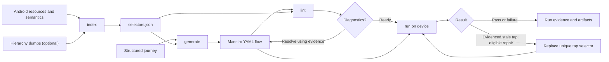

# maestro-flow

Index Android resources and semantics, generate and lint Maestro flows from structured journeys, and report device-run evidence. The CLI works independently of MCP; free-form prose must first be translated into structured steps by a person or agent.

## Setup

Node.js 24 or newer is required. Install the published package with `npm install -g @budaknyenyel/maestro-flow`. To develop from source, clone [android-kit](https://github.com/fridaysundaymood/android-kit) and [emu-lab](https://github.com/fridaysundaymood/emu-lab) next to this repository and build both dependencies first:

```sh
cd ../android-kit
npm install
npm run build --workspace @budaknyenyel/kit-schema
cd ../emu-lab
npm install
npm run build
cd ../maestro-flow
npm install
npm run build
```

The repository config installs local dependencies as copies. Run `npm ci` after rebuilding either sibling to refresh them. For publishing, build the project and run `node scripts/prepare-publish.mjs`. It prints a temporary package directory whose sibling dependencies are replaced with registry version ranges. Publish or pack that directory, then remove it; the source manifest is not changed. Publish the matching `@budaknyenyel/kit-schema` and `@budaknyenyel/emu-lab` versions first.

The CLI operations are `index`, `lint`, `generate`, `run`, and `doctor`. Start the stdio MCP server with `node dist/mcp/bin.js`. For device runs, install Java, Android SDK platform tools (`adb`), a device or emulator, and Maestro CLI `>=1.39.0 <=2.12.1`; run `maestro-flow doctor` to inspect prerequisites. Offline indexing and linting do not require a device. On Windows, install the Android SDK and Java, put their launchers on PATH, and start an emulator using Android Studio or the SDK tools.

## Workflow

1. Read app-specific `e2e/maestro/CONVENTIONS.md` when present and run `maestro-flow index`.
2. Prepare structured journey steps and expected UI, then use `maestro-flow generate`.
3. Run `maestro-flow lint` and resolve diagnostics using current resources or hierarchy evidence.
4. Run the flow alone with `maestro-flow run`, then run the suite to find state leakage. Never alter an expected value to conceal a bug.

Every operation has a corresponding MCP tool: `maestro_flow_index`, `maestro_flow_generate`, `maestro_flow_lint`, `maestro_flow_run`, and `maestro_flow_doctor`. Use `--json` for the kit-schema v1 result envelope. Exit codes are 0 for pass, 1 for fail or flaky, and 2 for error, blocked, or unsupported. The [agent-neutral skill](skill/SKILL.md) describes the full iteration workflow.

The workflow connects the selector index and structured journey to generated flows and device evidence:



The package root exports `toolDefinitions()` with JSON input schemas and async result-envelope handlers, plus `configSection`, `configSectionSchema`, `supportedSchemaMajors`, and `doctor()`. Importing it does not start the MCP server.

### CLI quickstart

The following examples use the synthetic `kit-fixture-app` checked out alongside this repository. Create `journey.md` in that app:

```md
# Open a board
Anchor: key:boards

| Action | Selector | Expected |
| --- | --- | --- |
| tap | text:General | text:General |
```

Replace resource keys and selectors with values found in the target app. From this repository:

```sh
node dist/cli/index.js index --project-root ../kit-fixture-app --json
node dist/cli/index.js generate --project-root ../kit-fixture-app --journey journey.md --app-id dev.androidkit.fixture --maestro-version 1.40.0 --locale default --output e2e/maestro/generated.yaml --json
node dist/cli/index.js lint --project-root ../kit-fixture-app --flow e2e/maestro/generated.yaml --json
node dist/cli/index.js doctor --json
node dist/cli/index.js run --project-root ../kit-fixture-app --flow e2e/maestro/generated.yaml --serial emulator-5554 --json
```

Use the actual resource key for the launch anchor and a device serial from `adb devices`; generation refuses to overwrite an existing flow. Add `--suite` and supply a suite path for a suite run. Repeat `--hierarchy` to index merged hierarchy dumps and `--locale` to generate multiple locale-specific flows. For evidence-supported selector repair, `run` accepts both `--repair-old` and `--repair-replacement`; `--screen-anchor` supplies the expected screen. Executable paths can be set as `maestro` and `adb` under `maestroFlow` in the trusted configuration.

To run under an existing emu-lab lease, supply its database, lease ID, and app package. A serial is optional with a lease:

```sh
node dist/cli/index.js run --project-root ../kit-fixture-app --flow e2e/maestro/generated.yaml --emu-lab-database .android-kit/emu-lab.sqlite --lease-id YOUR_LEASE_ID --package-name dev.androidkit.fixture --json
```

The database path is relative to `--project-root`. MCP accepts `emuLab: { "databasePath": "...", "leaseId": "...", "packageName": "..." }`; the same object can be set under `maestroFlow.emuLab` in configuration. Explicit options override configuration. Without emu-lab, pass `--serial` directly.

For locale setup, JSON journeys can express preconditions that Markdown tables cannot. The following illustrates the schema; use keys and navigation observed in your own synthetic app:

```json
{
  "title": "Open a board",
  "initialLocale": "default",
  "anchor": { "key": "boards" },
  "preconditions": [],
  "localePreconditions": {
    "in": [
      { "action": "tap", "selector": { "key": "settings" }, "locale": "default" },
      { "action": "tap", "selector": { "text": "Bahasa Indonesia" }, "locale": "default" }
    ]
  },
  "steps": [{ "action": "assertVisible", "selector": { "key": "boards" } }]
}
```

Save as `journey.json` and generate with `--journey journey.json --locale default --locale in`. Set preconditions to the actual UI needed to select each locale after cleared state.

### MCP client

The client-specific configuration location varies; a generic stdio server entry looks like:

```json
{
  "mcpServers": {
    "maestro-flow": {
      "command": "node",
      "args": ["/absolute/path/to/maestro-flow/dist/mcp/bin.js"]
    }
  }
}
```

Use an absolute Windows path such as `C:\\work\\maestro-flow\\dist\\mcp\\bin.js` on Windows. The stdio server uses its working directory as the project root. Trusted embedding hosts can supply `projectRoot` and `config` via `toolDefinitions(options)` or `createServer(options)`; MCP requests cannot override them. Other tool arguments use camelCase counterparts of CLI options, such as `appId`, `maestroVersion`, and `runId`. `locale` and `hierarchy` are arrays. The `journey` argument accepts a path or structured object; `selectorRepair` takes `{ "old": "...", "replacement": "..." }`.

### Configuration and lint rules

Optional `android-kit.yaml` has a `maestroFlow` section; explicit CLI options take precedence. For example:

```yaml
maestroFlow:
  rootScreens: [Boards]
  suppressions:
    - ruleId: MF006
      reason: "Synthetic fixture documents an unlabeled control"
      file: /absolute/path/to/flow.yaml
      line: 12
```

Suppressions require a known rule ID, a nonempty reason, and a file or line scope. Paths are matched against the linted flow path. Invalid suppressions are errors; unused suppressions are reported. Rule set version is `1.1.0`:

Without `--flow`, lint scans YAML flows recursively under `maestroFlow.flowsDir` (default `e2e/maestro`). Diagnostics use project-relative paths. MF001 requires close matching resource copy or an explicit stale-copy annotation; MF002 means the selector was not found in resources or the hierarchy and may be dynamic content. Entered text, its constituent tokens, and interpolated variables are treated as runtime data.

Lint refreshes `selectors.json` when it is missing, was created by a different indexer version, or its resource, source, or hierarchy inputs have changed. Refreshes are reported in the result evidence.

| Rule | Severity | Meaning |
| --- | --- | --- |
| MF001 | error | Selector resembles changed resource copy |
| MF002 | warning | Selector cannot be resolved from static evidence |
| MF003 | warning | Back on a configured root screen |
| MF004 | warning | Bare numeric assertion |
| MF005 | warning | Launch without a visible anchor wait |
| MF006 | warning | Coordinate tap |
| MF007 | error | Invalid suppression |
| MF008 | warning | Unused suppression |

The supported Maestro range is `>=1.39.0 <=2.12.1`; examples use 1.40.0. When a Maestro version is supplied to lint it is checked against this range. If a captured hierarchy shows a System UI not-responding dialog, run records it as environment evidence and retries the unchanged flow once; a persistent dialog blocks the run. Java, adb, and the emulator are device prerequisites, but their versions are not currently constrained by the tool. CI runs on Windows, macOS, and Linux with Node.js 24; this package declares Node.js 24 or newer.

The lint rule IDs are MF001 stale selector, MF002 unknown selector, MF003 root-screen Back, MF004 bare numeric assertion, MF005 missing launch anchor, MF006 coordinate tap, MF007 invalid suppression, and MF008 unused suppression. A hierarchy can contain sensitive information: keep screenshots and dumps local unless explicitly authorized to share them. Generated `selectors.json` and `.android-kit/` run artifacts are ignored by Git. No telemetry is sent.

## Development

See [CONTRIBUTING.md](CONTRIBUTING.md), [SECURITY.md](SECURITY.md), and [CHANGELOG.md](CHANGELOG.md). Use synthetic data only. The [implementation plan](IMPLEMENTATION_PLAN.md) records scope and milestones.

## License

[MIT](LICENSE)
